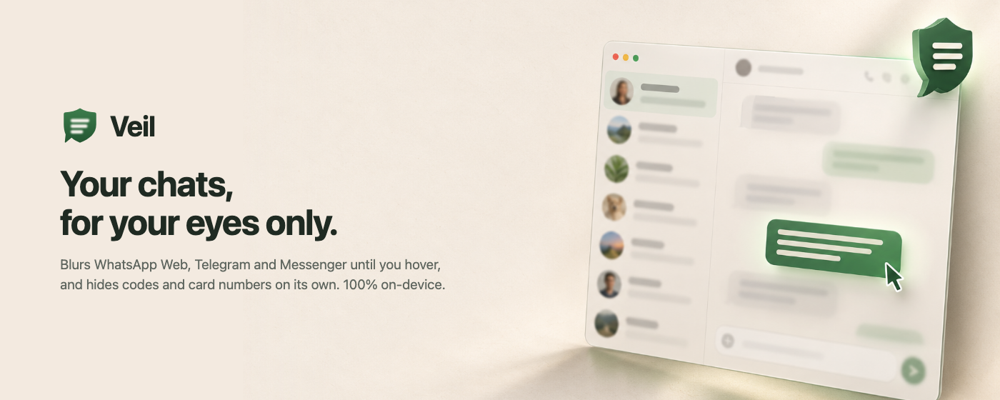
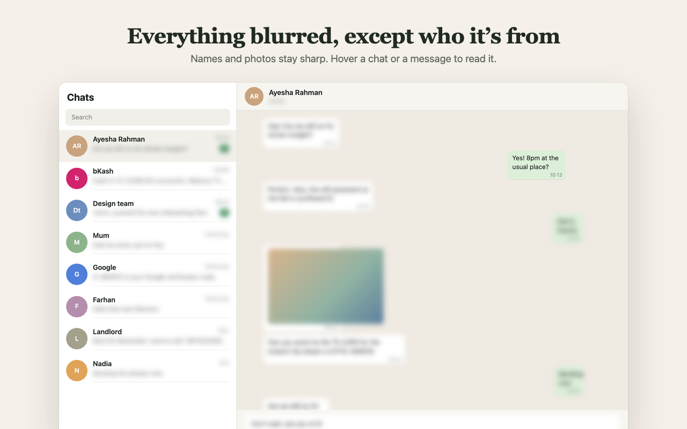
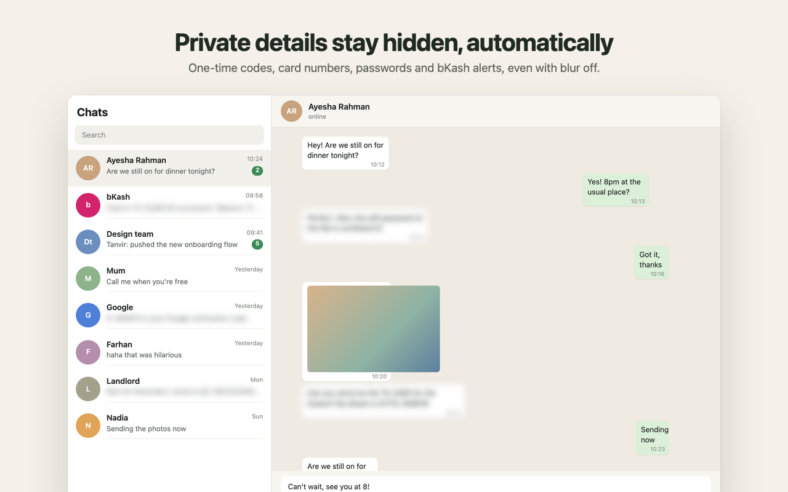
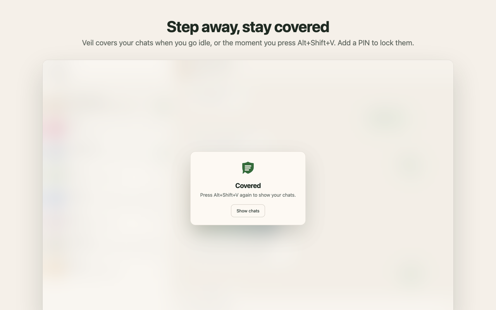
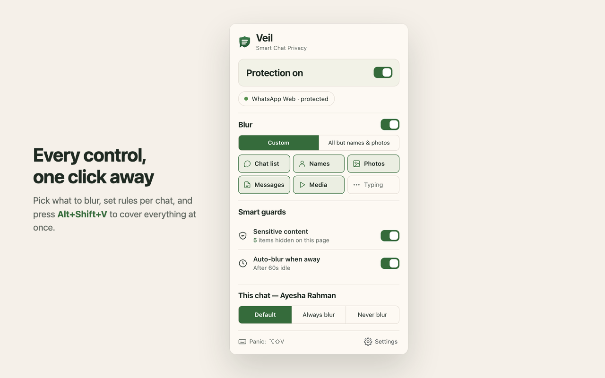

<p align="center"></p>

<h1 align="center">Veil — Smart Chat Privacy</h1>

<p align="center">A Chrome extension that blurs WhatsApp Web, Telegram Web and Messenger until you hover,<br>
and knows what to keep hidden. 100% on-device.</p>

---

Privacy blur extensions treat every message the same and only react when you do. Veil also watches the context:
it keeps one-time codes and card numbers blurred even when you turn message blur off, and hides your chats when
you step away.

<p align="center"></p>

| | |
|---|---|
|  |  |
|  |  |

_Screenshots show the real extension on a demo page with made-up chats (`npm run store:shots`)._

## Features

**Blur what you choose.** Chat-list previews, names, profile photos, messages, media and the typing box, per
site. Hover a chat row or a message to reveal all of it, or switch to _hover while holding Alt_ so nothing
reveals by accident.

**All but names & photos.** One switch blurs everything, including the left panel's previews, timestamps,
unread counts and the "last seen" line, and keeps only names and profile photos sharp.

**Sensitive-content detection.** Messages and previews that contain one-time codes, card numbers
(Luhn-verified), bank accounts and IBANs, passwords and PINs, phone numbers, emails, money and mobile-banking
alerts (bKash, Nagad, Rocket) or street addresses stay blurred whatever your other settings are. The rules work in
English and Bangla. Optional _deep scan_ uses Chrome's built-in Gemini Nano to catch personal or intimate
messages the rules miss, on-device.

**Away & lock.** Covers chats after you go idle, or when you switch to another app. Optionally needs a PIN to
uncover.

**Panic key.** <kbd>Alt</kbd>+<kbd>Shift</kbd>+<kbd>V</kbd> covers every chat tab at once. Press it again to
restore. <kbd>Alt</kbd>+<kbd>Shift</kbd>+<kbd>B</kbd> turns Veil on or off.

**Per-chat rules.** _Always blur_, _never blur_ or _hide from the list_ for any chat, from the popup or the
right-click menu.

## Privacy

No servers, no accounts, no analytics: Veil makes no network requests. Everything above runs inside your
browser. See [PRIVACY.md](PRIVACY.md).

## Install

- **Chrome Web Store:** coming soon.
- **From source:** `npm install && npm run build`, then open `chrome://extensions`, turn on _Developer mode_,
  click _Load unpacked_ and choose `.output/chrome-mv3`.

## Develop

```bash
npm install
npm run dev          # Chrome with the extension loaded and live reload
npm test             # unit tests (classifier)
npm run e2e          # builds, then runs Playwright against fixture pages served at the real chat URLs
npm run typecheck
npm run zip          # store-ready zip in .output/
npm run store:shots  # recapture store screenshots, then: python3 scripts/compose-store.py
```

Built with [WXT](https://wxt.dev), TypeScript and Manifest V3. There is no UI framework: the popup and settings
page are plain TypeScript and CSS.

### How it works

- `src/lib/adapters/` holds one file per site, containing only selectors: what to blur per category, which
  elements are chat rows and messages, and how to read the open chat's name. **When a site changes its markup,
  this is the only place to fix.**
- `src/lib/styles.ts` turns an adapter into a stylesheet keyed on classes on `<html>`. The blur is pure CSS,
  injected at `document_start`, so nothing flashes unblurred.
- `src/entrypoints/content.ts` flips those classes, tags sensitive messages (`data-veil-s`) as they arrive,
  applies chat rules and drives the full-page cover.
- `src/lib/classify.ts` holds the sensitive-content rules: pure functions with unit tests.
- `src/entrypoints/background.ts` handles panic, shortcuts, the context menu and Gemini Nano.

### Site support

| Site | Status |
|---|---|
| WhatsApp Web | Selectors checked against the live site (October 2026) |
| Telegram Web K and A | Selectors checked against both clients' open-source code |
| Messenger (messenger.com, facebook.com/messages) | Built on ARIA roles; needs testing on a logged-in session |

Broken on a site? Please open an issue or a pull request against its adapter file.

## Limitations

- The PIN stops a casual glance, not a determined person: anyone at your computer can turn extensions off.
- Deep scan needs a Chrome build and device that support Gemini Nano. Elsewhere it shows as unavailable.

## License

[MIT](LICENSE)
